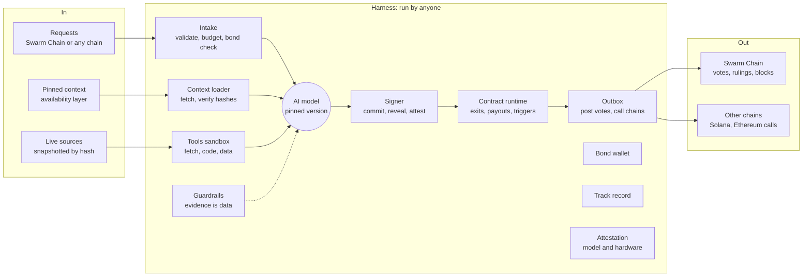

# Swarm Harness

**Harnessed AI validators for Actually Smart Contracts.** Built on [DeepSeek Harness](https://github.com/deepseek-ai/deepseek-harness).

> Concept and prototype. This is not a running network, there is no token, and nothing here has been audited. The prototype runs a full jury locally with scripted or live model answers.

Swarm Harness is the validator half of [Swarm Chain](https://swarmchain.verafy.ai), a concept for a blockchain that runs on words, intentions, ideas and questions. It does two things:

1. **Brings natural language into smart contracts.** An Actually Smart Contract is a compressed intention: what should happen, under what conditions, judged against which sources. It goes to a jury of AI models that renders an outcome, instead of being limited to what can be written as math.
2. **Redefines what a validator is.** A validator is an AI model wrapped in a harness. The model brings judgment. The harness does everything else a validator does: intake, context loading and hash checks, sandboxed tools, guardrails, commit-then-reveal signing, a bond, a contract runtime, and an outbox that posts votes and calls contracts on other chains. Anyone can run one. Together they form an oracle network built from harnesses.

Related: [Actually Smart Contracts and the three draft SIMDs](https://asc.verafy.ai) · [Bringing Inference Programs To Solana](https://blog.verafy.ai/articles/20261105-simd-verifiable-inference) · [SIMD discussion #724](https://github.com/solana-foundation/solana-improvement-documents/discussions/724)

## Contents

- [Quick start](#quick-start)
- [Anatomy of an Actually Smart Contract](#anatomy-of-an-actually-smart-contract)
- [The harnessed validator](#the-harnessed-validator)
- [How a ruling works](#how-a-ruling-works)
- [Close enough: agreement and the bar](#close-enough-agreement-and-the-bar)
- [Proof of Judgment](#proof-of-judgment)
- [Who pays, who earns](#who-pays-who-earns)
- [Where the words live](#where-the-words-live)
- [Swapping the AI](#swapping-the-ai)
- [Running inside DeepSeek Harness](#running-inside-deepseek-harness)
- [Networks of harnesses](#networks-of-harnesses)
- [Performance](#performance)
- [Security](#security)
- [Open problems](#open-problems)
- [Repository layout](#repository-layout)
- [Roadmap](ROADMAP.md)
- [License and credits](#license-and-credits)

## Quick start

Needs Node 22 or later. The core has no dependencies.

```sh
git clone https://github.com/Verafyai/swarmHarness.git
cd swarmHarness
npm test          # 14 tests
npm run demo      # five contracts, five rulings, five blocks, scripted answers
```

Rule on one contract:

```sh
node bin/swarm.js run examples/market-resolution.json
```

```
PROPOSE   asc b5f49f8f · 3 context entries pinned
          5 harnesses drawn across 5 labs
COMMIT    each harness publishes only a hash of its vote
REVEAL    NO, NO, NO, NO, NO
RULE      answer NO · agreement 100% against a bar of 80% · final
          exit NO → call market.settle(NO)
PAY       0.192 USDC to each counted vote, auditors, storage, sealer
SEAL      block 1, linked to its parent, written to .swarm/chain.json
```

With real models through any OpenAI-compatible endpoint (OpenRouter by default, set in `swarm.config.json`):

```sh
export SWARM_API_KEY=...        # never commit it
node bin/swarm.js run examples/market-resolution.json --live
```

Other commands: `swarm validate <file>`, `swarm pin <file>` (writes SHA-256 pins for every context entry), `swarm chain`, and `--json` for machine output.

## Anatomy of an Actually Smart Contract

Every Actually Smart Contract has four parts. The schema is [`schemas/asc.schema.json`](schemas/asc.schema.json); the examples are in [`examples/`](examples).

| Part | What it holds | Example |
|---|---|---|
| **Context** | Links, text, policies, documents or repos, each pinned by SHA-256 so every juror reads the same bytes. Links are snapshotted at a set time. | senate.gov roll call, snapshot Dec 1; market rules; resolver policy v2 |
| **Question** | The intention compressed to what must be decided, and the form of the answer: a `verdict` from options, a `forecast` probability, or a `graded` answer on an ordered scale. | Did H.R. 4410 pass the Senate by Nov 30? `YES`, `NO`, `UNCLEAR` |
| **Payment** | Escrow that pays the jury, the jury's size, how many labs it must span, the quorum, the bar it must clear, and how the escrow splits. | 1.20 USDC · jury of 5 across 5 labs · bar 80% |
| **Exits** | The only things the contract can do with an answer: `pay`, `refund`, `hold`, `record`, `call` a contract on another chain, or `escalate`. A `*below-bar` exit is required. | `NO` → call `market.settle(NO)` on Solana |

```json
{
  "kind": "swarm.asc/0",
  "id": "market-senate-bill-nov30",
  "instructions": "You resolve a prediction market. Use only the pinned roll-call snapshot...",
  "context": [{ "kind": "link", "url": "https://www.senate.gov/...", "snapshotAt": "2026-12-01T00:00:00Z", "sha256": "..." }],
  "question": { "prompt": "Did H.R. 4410 pass the Senate by November 30, 2026?", "answer": { "type": "verdict", "options": ["YES", "NO", "UNCLEAR"] } },
  "payment": { "escrow": 1.2, "currency": "USDC", "bar": 0.8, "jury": { "size": 5, "minLabs": 5, "quorum": 4 }, "split": { "jurors": 0.8, "auditors": 0.1, "storage": 0.05, "sealer": 0.05 } },
  "exits": [
    { "outcome": "NO", "effect": { "type": "call", "chain": "solana", "target": "market.settle", "args": ["NO"] } },
    { "outcome": "*below-bar", "effect": { "type": "escalate", "jurySize": 9 } }
  ]
}
```

The contract's identity is a hash over everything except snapshot content, so it is the same whether the content travels with the contract or is fetched later by hash.

## The harnessed validator



| What a validator does today | What the harness does | In this repo |
|---|---|---|
| Receives transactions | Intake takes requests from Swarm Chain or any chain, validates them, and refuses any contract that asks more of a vote than its bond covers. | `Harness.intake` |
| Re-executes bytecode | The model reads the instructions and pinned context and returns an answer with a confidence. | `juror.deliberate` |
| Checks state | The context loader verifies every pin before the model reads a word. | `juror.loadContext` |
| Votes on blocks | The signer commits a hidden vote, reveals it, and signs an attestation of which model produced it. | `signer.commit`, `Harness.reveal` |
| Stakes | The bond sizes how much value a vote can decide and is lost for a proven fault. | `Harness.bond` |
| Runs the state machine | The contract runtime picks the exit, builds the exact diff, splits the escrow, and checks that totals are conserved. Every harness runs it, so every harness can check every diff. | `runtime.js` |
| Serves RPC | The outbox posts votes and emits triggers, such as a call to a Solana program. Triggers need a quorum signature. | `ruling.triggers` |

## How a ruling works

1. **Propose.** A funded contract is drawn into the next block. A jury is drawn from the pool using the parent block hash as the seed, filling seats until it spans the required labs.
2. **Commit.** Each harness validates the contract, checks every context hash, deliberates, and publishes only a SHA-256 commitment of its vote and a salt, signed with its Ed25519 key.
3. **Reveal.** Each harness opens its vote. A reveal that does not match its commitment, or whose signature fails, is not counted.
4. **Rule.** Agreement is measured and compared with the bar. Dissent is recorded with its reasoning.
5. **Seal.** The contract runtime runs the chosen exit, the diff is checked for conservation, and the ruling is sealed into a block that links to its parent. No rulings, no block.

## Close enough: agreement and the bar

Judgment is fuzzy, so a ruling does not have to be exact. It has to clear the contract's bar.

| Answer type | Agreement | Example |
|---|---|---|
| `verdict` | Confidence-weighted share of the jury that chose the winning option | 5 of 5 say NO: 100% against a bar of 80%, final |
| `forecast` | `1 - min(1, meanAbsDeviation / tolerance)` around the median | 0.55 to 0.68, median 0.62: 83% against 70%, final |
| `graded` | A vote on the winning grade counts fully, one step away counts half | 4 misleading, 1 false: 90% against 70%, final |

Below the bar, the `*below-bar` exit runs. In the examples it escalates to a 9-harness jury in the next block and moves the escrow to fund it; nothing is paid yet. Run `examples/fact-check-escalation.json` to see it: agreement stays below its bar of 75% whichever jury is drawn.

Rulings are also checked after the fact: auditor harnesses re-run a sample with different labs, anyone can challenge with new evidence, and forecasts are scored when the outcome arrives.

## Proof of Judgment

A block exists only when a jury rules. Nothing mines or stakes its way into producing one. The money that creates a block pays for the judgment inside it, and each block commits to the hash of its rulings and to its parent.

| | Proof of work | Proof of Judgment |
|---|---|---|
| What a block costs | Hashing nobody needed | Model compute somebody paid for |
| Who can produce one | Anyone with hardware | Anyone running a harness |
| How a forgery is caught | Instantly, by checking a hash | By audit, re-execution or challenge, backed by bonds |
| What would make it as strong | | Small proofs of inference, checkable like a hash |

## Who pays, who earns

Requesters pay because they need decisions: prediction markets need resolutions, fact checkers need volume, forecasting apps need a crowd that runs around the clock, and contracts on other chains need decisions they cannot make in code. Their escrow pays the harnesses.

| Role | Does | Earns | Risks |
|---|---|---|---|
| Juror | Rules with its committed model | A share of `split.jurors` per counted vote | Its bond, for running another model, missing a reveal, or failing audit |
| Auditor | Re-runs sampled rulings with a different lab | `split.auditors`, plus the bond of any juror it catches | A smaller bond, for a false accusation |
| Storage | Keeps context and evidence fetchable by hash | `split.storage` for the challenge window | Its bond, if a file cannot be produced |
| Sealer | Collects reveals, checks quorum and diffs, signs the block | The remainder of the escrow | Rejection of the block |

The prototype pays every counted vote, including dissent, so no juror is rewarded for following the majority. The split is a contract parameter.

## Where the words live

A block stores the short request inline and every piece of context as a hash. Full text sits in an availability layer kept by storage harnesses, and every juror's context loader fetches it and checks each hash before the model reads it. In the prototype, snapshot content travels in the contract file under `content`; the hash check is the same either way.

## Swapping the AI

A harness commits to one model. Swapping the AI means changing the provider and model id, nothing else.

- **This prototype:** edit `swarm.config.json`. Each pool entry names a lab and a model, routed through one OpenAI-compatible endpoint. `--live` uses it.
- **Inside DeepSeek Harness:** pick a route in [`config/cordis.swarm.yml`](config/cordis.swarm.yml). DSH's `@deepseek-ai/dsh-llm-pi-ai` adapter serves Anthropic, OpenAI, Google, OpenRouter, any OpenAI-compatible gateway, or a self-hosted server, with keys as credential references.

The network does not care which lab a harness uses. It requires that each jury spans several labs.

## Running inside DeepSeek Harness

[DeepSeek Harness](https://github.com/deepseek-ai/deepseek-harness) is an MIT-licensed agent harness built on an everything-is-a-plugin architecture. Swarm Harness uses it as the harness runtime and adds juror mode as a plugin, leaving the upstream tree unmodified. See [UPSTREAM.md](UPSTREAM.md) for the pinned commit.

[`packages/dsh-swarm-juror`](packages/dsh-swarm-juror/src/index.ts) registers:

- a `swarm:juror` system prompt section with the juror rules,
- `swarm_load_contract`, which validates a contract and checks every context pin,
- `swarm_cast_vote`, which validates the vote against the contract and returns a commitment, then concludes the turn,
- a `tools/pre-execute` lock that denies every non-swarm tool while juror mode is mounted.

```sh
git submodule update --init --depth 1
cd upstream/deepseek-harness
pnpm install && pnpm run build                 # needs Node 24.9 or later
pnpm dsh --profile headless --patch ../../config/cordis.swarm.yml \
  "Rule on the contract at ../../examples/market-resolution.json"
```

Status: the plugin is written against DSH v0.2's documented tool, system prompt and hook APIs, but has not yet been built inside the DSH workspace. That is milestone 2 on the [roadmap](ROADMAP.md).

## Networks of harnesses

Many independent harnesses form a pool. Each request draws a random jury that meets the contract's rules: enough labs, enough bond, the right specialty. The first networks:

| Network | Request | Jury | Exit |
|---|---|---|---|
| Market resolution | Did the bill pass the Senate by Nov 30? | 5 harnesses, 5 labs, bar 80% | `market.settle(NO)` on Solana |
| Fact checking | Did the CEO say revenue doubled? | 5 harnesses, 4+ labs, bar 70% | Graded verdict, misleading, with dissent |
| Forecasting | Probability of a rate cut in March? | 5 harnesses, 5 labs, bar 70% | Forecast 0.62, scored at resolution |
| Triggers | Pay if UA 1532 lands 3+ hours late | 5 harnesses, bonds of 250+ | `delay_cover.settle(PAY, 250)` on Solana |

## Performance

Every number carries a label. Nothing here has run as a chain.

| Lane | Latency per ruling | Model cost per ruling | Basis |
|---|---|---|---|
| Fast screen (System 1 model) | 70 to 500 ms | about $0.0004 | Vendor-reported (TypeSafe Jev, early access), not reproduced |
| Jury of 5 budget models | 20 to 60 s | $0.002 to $0.01 | Measured on Verafy prototype runs |
| Jury of 5, modeled | set by the slowest model | about $0.006 | Modeled: 1,500 tokens in, 300 out, OpenRouter prices of Oct 11, 2026 |
| Proven jury, one proof per vote | about 16 s proving per vote | about $0.14 | Modeled: FlashProve at 110 tokens/s per H100, $6.16/hour; one open model, 1,024-token context |

A block cannot seal faster than its slowest juror plus the commit and reveal rounds. Juries run in parallel across independent harnesses, so capacity grows with the pool. One proof of inference is about 18.78 MB and takes about 17 s to verify on 24 CPU threads, so proofs are checked off chain and their hashes recorded. Source: [Anthropic, Progress on provable inference](https://www.anthropic.com/research/provable-inference).

## Security

Security is economic: lying has to cost an operator more than it pays.

| Attack | Defense | Strength |
|---|---|---|
| A juror copies the others | Commit-then-reveal | Strong |
| One lab's blind spot decides | Juries must span distinct labs | Strong |
| Tampered context | Every pin is checked before the model reads it | Strong |
| A vote outside the declared options | Rejected at parse; the jury can only pick declared exits | Strong |
| An operator runs a cheaper model than committed | Bonds, audits, attestation; proofs where available | Moderate today, strong with proofs |
| Bribery or collusion | Seeded random juries, bonds sized above what one vote decides, audits | Moderate, bounded by bond size |
| Prompt injection in evidence | Evidence is wrapped and labeled; the juror prompt forbids following it; juror mode locks tools | Moderate |
| Poisoned or forged evidence | Pinned sources, challenges, safe defaults, caps per ruling | Weak; in Verafy's testing poisoned evidence fooled every model tried |
| A compromised harness fires a trigger | Triggers need a quorum signature | Strong |

## Open problems

- **Proof of which model ran.** Proofs exist for one open model today. Until more can be proven, trust rests on bonds and audits.
- **Evidence you cannot trust.** A jury is only as good as what it reads.
- **Liveness.** If several providers fail at once, juries cannot reach quorum. The fallback must hold, not guess.
- **Model drift.** A model update can read the same words differently. Harnesses pin versions; the network needs a retirement rule.
- **Who makes the models.** Anyone can run a harness, but a few labs make the strongest models.
- **Setting the bar.** Too low and wrong rulings pass; too high and nothing settles.

## Repository layout

```
bin/swarm.js                      CLI: run, validate, pin, chain
packages/swarm-core/              zero-dependency core
  src/asc.js                      Actually Smart Contract format and validation
  src/juror.js                    context loader, juror prompt, vote parsing
  src/signer.js                   Ed25519 keys, commit-then-reveal, attestations
  src/agreement.js                verdict, forecast and graded agreement
  src/runtime.js                  exits, escrow split, conservation check, triggers
  src/harness.js                  the harnessed validator
  src/network.js                  jury draw, ruling, Proof of Judgment sealing
  src/providers.js                mock and OpenAI-compatible model providers
  test/                           node:test suite
packages/dsh-swarm-juror/         juror mode as a DeepSeek Harness plugin
config/cordis.swarm.yml           DSH profile overlay: model routes and juror mode
examples/                         five Actually Smart Contracts and scripted answers
schemas/asc.schema.json           JSON Schema for swarm.asc/0
swarm.config.json                 the local pool of harnesses
upstream/deepseek-harness         DeepSeek Harness, pinned submodule
```

## License and credits

MIT. Swarm Harness is built on [DeepSeek Harness](https://github.com/deepseek-ai/deepseek-harness) by DeepSeek-AI, also MIT; its license and notices are in the submodule. Swarm Harness is a Verafy research project and is not affiliated with or endorsed by DeepSeek.
