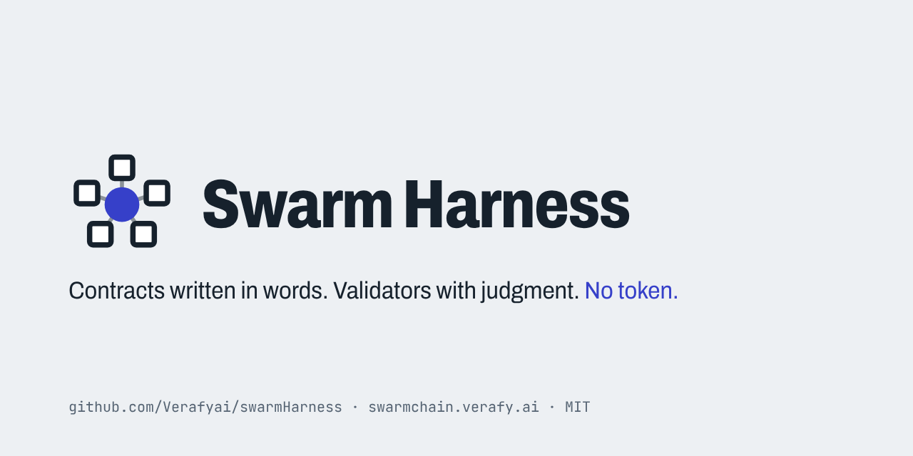
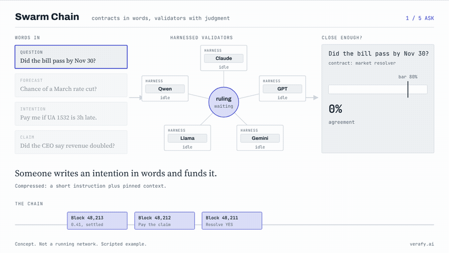
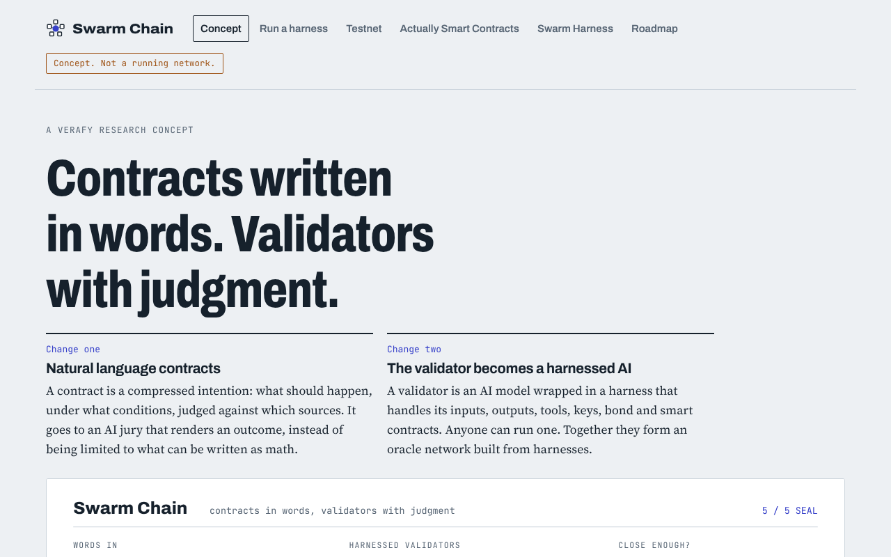
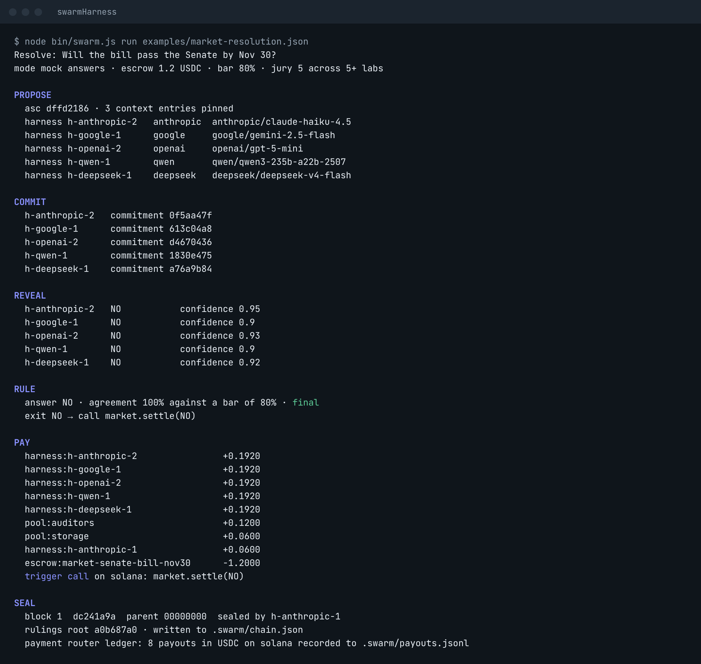
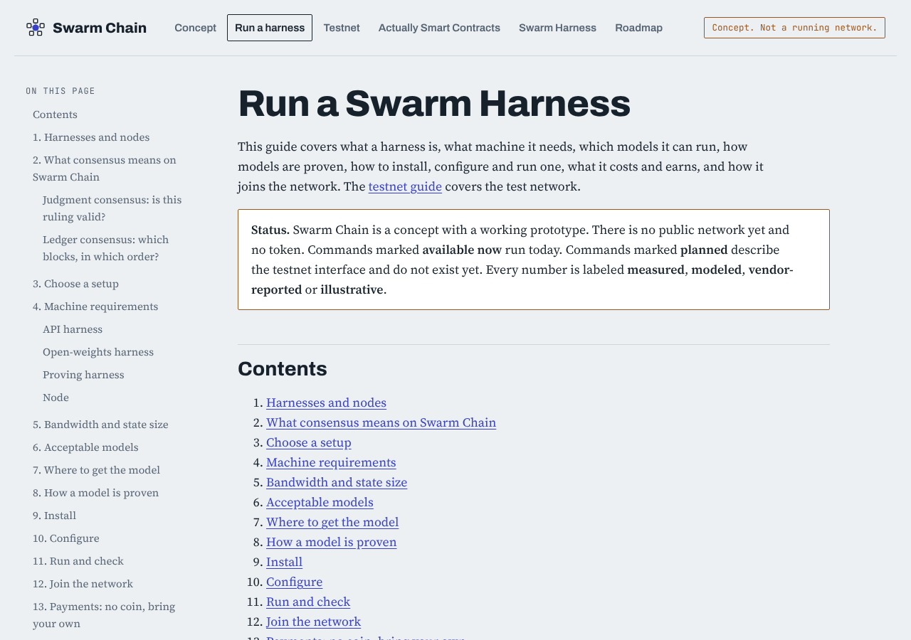
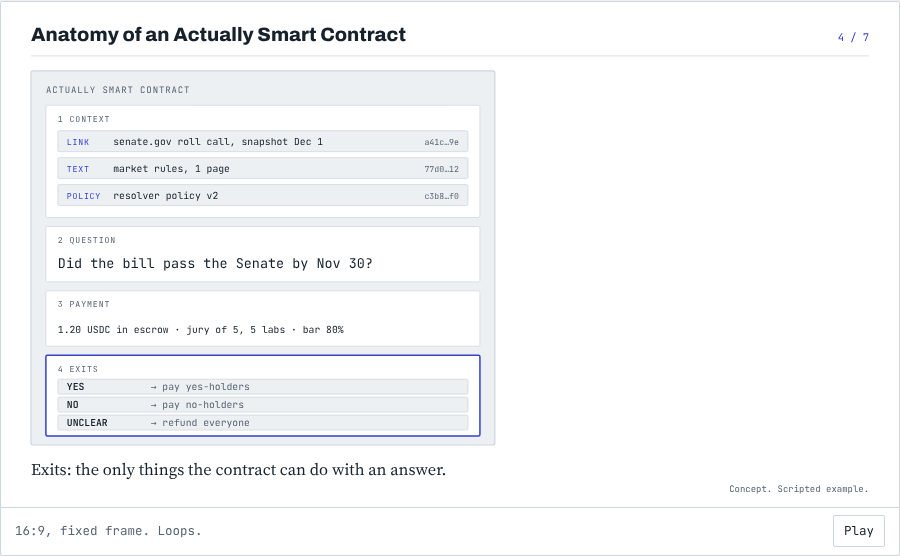
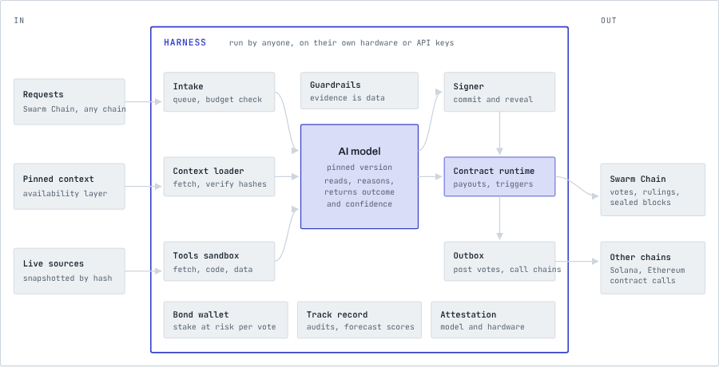
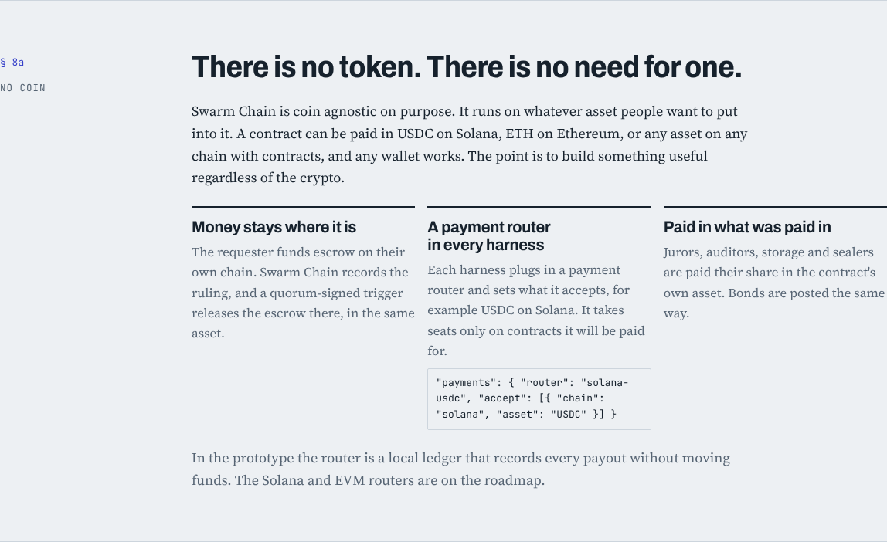
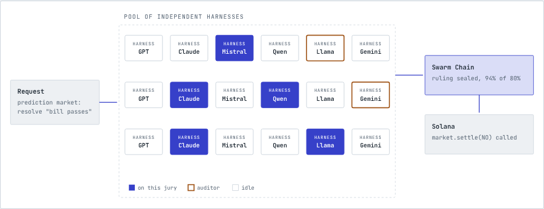

<p align="center">
  
</p>

# Swarm Harness

**Harnessed AI validators for Actually Smart Contracts.** The validator for [Swarm Chain](https://swarmchain.verafy.ai), built on [DeepSeek Harness](https://github.com/deepseek-ai/deepseek-harness). MIT licensed. No token.

[Concept site](https://swarmchain.verafy.ai) · [Run a harness](docs/run-a-harness.md) · [Testnet](docs/testnet.md) · [The essay](docs/blog/bringing-inference-programs-to-solana.md) · [The three draft SIMDs](docs/simds) · [SIMD discussion #724](https://github.com/solana-foundation/solana-improvement-documents/discussions/724) · [Roadmap](ROADMAP.md)

> **Status.** A working prototype, not a running network. Nothing here has been audited. What is real today: a full jury on one machine, live rulings by five labs' models, and juror mode inside DeepSeek Harness. See [what has been measured](#what-runs-today).

<p align="center">
  
</p>

## Why this exists

Smart contracts can only enforce what someone can write as math. Most of what people actually want enforced isn't math: a policy, a promise, a claim, a condition about the world. Today those decisions leave the chain and come back as somebody's word.

AI models can now read and weigh almost anything, and there is early research on proving which model produced an answer. Swarm Harness puts the two together: a contract written in words, ruled on by a jury of AI models from different labs, with every vote committed, revealed, signed and open to challenge.

Three choices shape the project:

- **No token.** There is no Swarm coin and no need for one. Contracts are paid in whatever asset the requester holds, on whatever chain they hold it, and the harnesses are paid in the same asset. Coin agnostic is the point: it should be useful regardless of the crypto.
- **No venture capital.** This is being built without outside money so the idea has to stand on its own.
- **Copy it.** Everything is MIT licensed. If it works, other people will copy it, and they are welcome to. The goal is a prototype that is useful.

## What it is

Swarm Harness does two things.

1. **It brings natural language into smart contracts.** An Actually Smart Contract is a compressed intention: what should happen, under what conditions, judged against which sources, paid for how, and what it may do with the answer. It goes to a jury of AI models that renders an outcome, instead of being limited to what can be written as code.
2. **It redefines what a validator is.** A validator is an AI model wrapped in a harness. The model brings judgment. The harness does everything else a validator does: intake, context loading and hash checks, sandboxed tools, guardrails, commit-then-reveal signing, a bond, a contract runtime, a payment router, and an outbox that posts votes and calls contracts on other chains. Anyone can run one. Together they form an oracle network built from harnesses.

<p align="center">
  
</p>

## Contents

- [What runs today](#what-runs-today)
- [Quick start](#quick-start)
- [Run a harness](#run-a-harness)
- [Anatomy of an Actually Smart Contract](#anatomy-of-an-actually-smart-contract)
- [The harnessed validator](#the-harnessed-validator)
- [How a ruling works](#how-a-ruling-works)
- [Consensus](#consensus)
- [Close enough: agreement and the bar](#close-enough-agreement-and-the-bar)
- [Proof of Judgment](#proof-of-judgment)
- [No coin: payments and the payment router](#no-coin-payments-and-the-payment-router)
- [Who pays, who earns](#who-pays-who-earns)
- [Where the words live](#where-the-words-live)
- [Swapping the AI](#swapping-the-ai)
- [Running inside DeepSeek Harness](#running-inside-deepseek-harness)
- [Networks of harnesses](#networks-of-harnesses)
- [Performance and state size](#performance-and-state-size)
- [Security](#security)
- [Open problems](#open-problems)
- [Swarm Harness and Swarm Chain](#swarm-harness-and-swarm-chain)
- [Read more](#read-more)
- [Repository layout](#repository-layout)
- [License and credits](#license-and-credits)

## What runs today

| | Status | Evidence |
|---|---|---|
| A full jury on one machine: contracts, pinned context, commit and reveal, agreement against the bar, exits, payouts, linked blocks | Works | `npm test` (17 tests), `npm run demo` |
| Live rulings by five labs' models through OpenRouter | **Measured** Nov 6, 2026: five contracts, 5.9 to 30.1 s each, $0.0163 in total | [results/live-2026-11-06.md](results/live-2026-11-06.md) |
| Juror mode inside DeepSeek Harness: five DSH processes on five labs' models, block sealed from their reveals | **Measured** Nov 6, 2026: all five voted NO, 100% against an 80% bar; 24 of 24 non-swarm tools denied | [docs/dsh-juror.md](docs/dsh-juror.md) |
| Payment router: accept lists, a local payout ledger | Works; on-chain routers planned | `swarm.config.json`, `.swarm/payouts.jsonl` |
| A network of harnesses, bonds, auditors, challenges, testnet | Planned | [ROADMAP.md](ROADMAP.md), [docs/testnet.md](docs/testnet.md) |

## Quick start

Needs Node 22 or later. The core has no dependencies.

```sh
git clone https://github.com/Verafyai/swarmHarness.git
cd swarmHarness
npm test          # 17 tests
npm run demo      # five contracts, five rulings, five blocks, scripted answers
```

<p align="center">
  
</p>

With real models through any OpenAI-compatible endpoint (OpenRouter by default):

```sh
export SWARM_API_KEY=...        # never commit it
node bin/swarm.js doctor --live
node bin/swarm.js run examples/market-resolution.json --live
```

Other commands: `swarm doctor [--live]`, `swarm validate <file>`, `swarm pin <file>` (writes SHA-256 pins for every context entry), `swarm seal <file> <juror-dir...>` (seals a block from reveals that separate harness processes wrote, such as DSH jurors), `swarm chain`, and `--json` for machine output.

## Run a harness

The full guide is **[docs/run-a-harness.md](docs/run-a-harness.md)**, also on the site as [Run a harness](https://swarmchain.verafy.ai/run). It covers harnesses and nodes, consensus, machine requirements for API, open-weights and proving harnesses, bandwidth and state size, acceptable models, where to get them, how a model is proven, install, configure, run, joining the network, payments, costs and earnings. The testnet plan is in **[docs/testnet.md](docs/testnet.md)**.

| Setup | Machine | Model |
|---|---|---|
| API harness | 2 vCPU, 4 GB RAM, 20 GB SSD, no GPU | Hosted, through an API key |
| Open-weights harness | 1 x 80 GB GPU, 128 GB RAM for `gpt-oss-120b`; larger models need 4 to 8 GPUs | On your machine, through vLLM (`scripts/run-vllm.sh`) |
| Proving harness | 1 x 80 GB GPU and about 290 GB host memory (vendor-reported) | Llama 4 Maverick only, research |
| Node | 8 vCPU, 32 GB RAM, 2 TB NVMe | None |

```sh
bash scripts/setup-ubuntu.sh            # Node 22, clone, test, demo
bash scripts/setup-ubuntu.sh --gpu      # plus GPU checks
MODEL=openai/gpt-oss-120b bash scripts/run-vllm.sh
node bin/swarm.js doctor --live --config swarm.config.local.json
```

<p align="center">
  
</p>

## Anatomy of an Actually Smart Contract

<p align="center">
  
</p>

Every Actually Smart Contract has four parts. The schema is [`schemas/asc.schema.json`](schemas/asc.schema.json); the examples are in [`examples/`](examples).

| Part | What it holds | Example |
|---|---|---|
| **Context** | Links, text, policies, documents or repos, each pinned by SHA-256 so every juror reads the same bytes. Links are snapshotted at a set time. | senate.gov roll call, snapshot Dec 1; market rules; resolver policy v2 |
| **Question** | The intention compressed to what must be decided, and the form of the answer: a `verdict` from options, a `forecast` probability, or a `graded` answer on an ordered scale. | Did H.R. 4410 pass the Senate by Nov 30? `YES`, `NO`, `UNCLEAR` |
| **Payment** | Escrow in any asset on any chain, the jury's size, how many labs it must span, the quorum, the bar it must clear, and how the escrow splits. | 1.20 USDC on Solana · jury of 5 across 5 labs · bar 80% |
| **Exits** | The only things the contract can do with an answer: `pay`, `refund`, `hold`, `record`, `call` a contract on another chain, or `escalate`. A `*below-bar` exit is required. | `NO` → call `market.settle(NO)` on Solana |

```json
{
  "kind": "swarm.asc/0",
  "id": "market-senate-bill-nov30",
  "instructions": "You resolve a prediction market. Use only the pinned roll-call snapshot...",
  "context": [{ "kind": "link", "url": "https://www.senate.gov/...", "snapshotAt": "2026-12-01T00:00:00Z", "sha256": "..." }],
  "question": { "prompt": "Did H.R. 4410 pass the Senate by November 30, 2026?", "answer": { "type": "verdict", "options": ["YES", "NO", "UNCLEAR"] } },
  "payment": { "escrow": 1.2, "currency": "USDC", "chain": "solana", "bar": 0.8, "jury": { "size": 5, "minLabs": 5, "quorum": 4 }, "split": { "jurors": 0.8, "auditors": 0.1, "storage": 0.05, "sealer": 0.05 } },
  "exits": [
    { "outcome": "NO", "effect": { "type": "call", "chain": "solana", "target": "market.settle", "args": ["NO"] } },
    { "outcome": "*below-bar", "effect": { "type": "escalate", "jurySize": 9 } }
  ]
}
```

The contract's identity is a hash over everything except snapshot content, so it is the same whether the content travels with the contract or is fetched later by hash.

## The harnessed validator

<p align="center">
  
</p>

| What a validator does today | What the harness does | In this repo |
|---|---|---|
| Receives transactions | Intake validates each contract, refuses one that asks more of a vote than its bond covers, and refuses payment in assets it doesn't accept. | `Harness.intake` |
| Re-executes bytecode | The model reads the instructions and pinned context and returns an answer with a confidence. | `juror.deliberate` |
| Checks state | The context loader verifies every pin before the model reads a word. | `juror.loadContext` |
| Votes on blocks | The signer commits a hidden vote, reveals it, and signs an attestation of which model produced it. | `signer.commit`, `Harness.reveal` |
| Stakes | The bond sizes how much value a vote can decide and is lost for a proven fault. | `Harness.bond` |
| Runs the state machine | The contract runtime picks the exit, builds the exact diff, splits the escrow, and checks that totals are conserved. | `runtime.js` |
| Gets paid | The payment router settles the harness's share where the contract was paid. | `payments.js` |
| Serves RPC | The outbox posts votes and emits triggers, such as a call to a Solana program. Triggers need a quorum signature. | `ruling.triggers` |

## How a ruling works

1. **Propose.** A funded contract is drawn into the next block. A jury is drawn from the pool using the parent block hash as the seed, filling seats until it spans the required labs.
2. **Commit.** Each harness validates the contract, checks every context hash, deliberates, and publishes only a SHA-256 commitment of its vote and a salt, signed with its Ed25519 key.
3. **Reveal.** Each harness opens its vote. A reveal that does not match its commitment, or whose signature fails, is not counted.
4. **Rule.** Agreement is measured and compared with the bar. Dissent is recorded with its reasoning.
5. **Seal.** The contract runtime runs the chosen exit, the diff is checked for conservation, the ruling is sealed into a block that links to its parent, and the payment router records or settles the payouts. No rulings, no block.

## Consensus

Consensus has two layers. The full definition is in [the guide](docs/run-a-harness.md#2-what-consensus-means-on-swarm-chain).

- **Judgment consensus** decides whether a ruling is valid: the jury was drawn correctly across labs, at least a quorum revealed votes that match their commitments, every answer is in bounds, the bar was or was not cleared, and the diff matches the exit and conserves totals. Every node checks every rule.
- **Ledger consensus** decides block order: a sealer rotation over the node set, with a block final at two thirds of node signatures (proposed for testnet). Rulings inside a final block can still be challenged during their window; a challenge appends a new ruling and never erases the old one.

## Close enough: agreement and the bar

Judgment is fuzzy, so a ruling does not have to be exact. It has to clear the contract's bar.

| Answer type | Agreement | Example |
|---|---|---|
| `verdict` | Confidence-weighted share of the jury that chose the winning option | 5 of 5 say NO: 100% against a bar of 80%, final |
| `forecast` | `1 - min(1, meanAbsDeviation / tolerance)` around the median | Live, Nov 6: forecasts 0.35 to 0.65, 55% against a bar of 70%, below the bar |
| `graded` | A vote on the winning grade counts fully, one step away counts half | 4 misleading, 1 false: 90% against 70%, final |

Below the bar, the `*below-bar` exit runs. In the examples it escalates to a 9-harness jury in the next block and moves the escrow to fund it; no juror is paid. Rulings are also checked after the fact: auditor harnesses re-run a sample with different labs, anyone can challenge with new evidence, and forecasts are scored when the outcome arrives.

## Proof of Judgment

A block exists only when a jury rules. Nothing mines or stakes its way into producing one. The money that creates a block pays for the judgment inside it, and each block commits to the hash of its rulings and to its parent.

| | Proof of work | Proof of Judgment |
|---|---|---|
| What a block costs | Hashing nobody needed | Model compute somebody paid for |
| Who can produce one | Anyone with hardware | Anyone running a harness |
| How a forgery is caught | Instantly, by checking a hash | By audit, re-execution or challenge, backed by bonds |
| What would make it as strong | | Small proofs of inference, checkable like a hash |

## No coin: payments and the payment router

<p align="center">
  
</p>

**There is no token, and there is no need for one.** A contract is paid in whatever asset the requester chooses, on the chain where they hold it: USDC or SOL on Solana, ETH or any ERC-20 on Ethereum. Any wallet works. The money never moves to Swarm Chain: escrow is held on the source chain, Swarm Chain records the ruling, and a quorum-signed trigger releases the escrow there, in the same asset.

Each harness plugs in a **payment router** that decides which payments it accepts and where its share goes:

```json
{
  "payments": {
    "router": "ledger",
    "accept": [{ "chain": "solana", "asset": "USDC" }],
    "book": { "harness:h-anthropic-1": { "solana": "<your Solana address>" } }
  }
}
```

| Router | Status | What it does |
|---|---|---|
| `ledger` | Available now, the default | Records every payout to `.swarm/payouts.jsonl`. Nothing moves on any chain. |
| `solana-usdc` | Planned | Releases escrow held by a Solana program, in USDC or any SPL token, with a quorum-signed trigger |
| `evm` | Planned | The same for Ethereum and EVM chains, in ETH or any ERC-20 |

A harness only takes seats on contracts paying in an asset on its `accept` list. Bonds are posted the same way, in the asset of the chain the harness earns on.

## Who pays, who earns

Requesters pay because they need decisions: prediction markets need resolutions, fact checkers need volume, forecasting apps need a crowd that runs around the clock, and contracts on other chains need decisions they cannot make in code.

| Role | Does | Earns, in the contract's asset | Risks |
|---|---|---|---|
| Juror | Rules with its committed model | A share of `split.jurors` per counted vote | Its bond, for running another model, missing a reveal, or failing audit |
| Auditor | Re-runs sampled rulings with a different lab | `split.auditors`, plus the bond of any juror it catches | A smaller bond, for a false accusation |
| Storage | Keeps context and evidence fetchable by hash | `split.storage` for the challenge window | Its bond, if a file cannot be produced |
| Sealer | Collects reveals, checks quorum and diffs, signs the block | The remainder of the escrow | Rejection of the block |

Every counted vote is paid, including dissent, so no juror is rewarded for following the majority. There is no block reward. Costs and earnings are worked through in [the guide](docs/run-a-harness.md#14-what-it-costs).

## Where the words live

A block stores the short request inline and every piece of context as a hash. Full text sits in an availability layer kept by storage harnesses, and every juror's context loader fetches it and checks each hash before the model reads it. In the prototype, snapshot content travels in the contract file under `content`; the hash check is the same either way.

## Swapping the AI

A harness commits to one model. Swapping the AI means changing the provider and model id, nothing else.

- **This prototype:** edit `swarm.config.json`. Each pool entry names a lab and a model, routed through an OpenAI-compatible endpoint, which can be a local vLLM server (`swarm.config.local.json`).
- **Inside DeepSeek Harness:** pick a route in [`config/cordis.swarm.yml`](config/cordis.swarm.yml). DSH's `@deepseek-ai/dsh-llm-pi-ai` adapter serves Anthropic, OpenAI, Google, OpenRouter, any OpenAI-compatible gateway, or a self-hosted server, with keys as credential references.

The network does not care which lab a harness uses. It requires that each jury spans several labs.

## Running inside DeepSeek Harness

[DeepSeek Harness](https://github.com/deepseek-ai/deepseek-harness) is an MIT-licensed agent harness built on an everything-is-a-plugin architecture. Swarm Harness uses it as the harness runtime and adds juror mode as a plugin, leaving the upstream tree unmodified. See [UPSTREAM.md](UPSTREAM.md) for the pinned commit.

[`packages/dsh-swarm-juror`](packages/dsh-swarm-juror/src/index.ts) registers:

- a `swarm:juror` system prompt section with the juror rules,
- `swarm_load_contract`, which validates a contract and checks every context pin,
- `swarm_cast_vote`, which validates the vote, signs a commitment and an attestation, keeps the vote and salt in a private reveal file, returns only the commitment, and concludes the turn,
- a tool lock: each juror agent is offered only the two swarm tools (`tools.restrict`), and a `tools/pre-execute` gate denies any other call,
- a stop-boundary reminder: a juror that answers in prose instead of calling `swarm_cast_vote` is told, at most twice, that only the tool call counts.

```sh
git submodule update --init --depth 1
cd upstream/deepseek-harness
CI=true npx -y pnpm@11.28.5 install --frozen-lockfile   # needs Node 24.9 or later
CI=true npx -y pnpm@11.28.5 run build
cd ../..
node scripts/dsh-juror.mjs setup                        # link the plugin into the headless profile
node scripts/dsh-juror.mjs vote --lab anthropic         # one DSH juror, scripted model, no key
node scripts/dsh-juror.mjs jury                         # five DSH jurors, then swarm seal
SWARM_API_KEY=... node scripts/dsh-juror.mjs jury --route openrouter   # five labs' live models
```

Status: milestone 2 is met. Five DeepSeek Harness processes on five labs' models (one `dsh-llm-pi-ai` route each, through OpenRouter) ruled on `examples/market-resolution.json` and `swarm seal` sealed the block from their reveals. See [docs/dsh-juror.md](docs/dsh-juror.md) for the run, and [docs/dsh-gaps.md](docs/dsh-gaps.md) for what DSH does not expose.

## Networks of harnesses

<p align="center">
  
</p>

Many independent harnesses form a pool. Each request draws a random jury that meets the contract's rules: enough labs, enough bond, the right specialty, an accepted payment. The first networks:

| Network | Request | Jury | Exit |
|---|---|---|---|
| Market resolution | Did the bill pass the Senate by Nov 30? | 5 harnesses, 5 labs, bar 80% | `market.settle(NO)` on Solana |
| Fact checking | Did the CEO say revenue doubled? | 5 harnesses, 4+ labs, bar 70% | Graded verdict, misleading, with dissent |
| Forecasting | Probability of a rate cut in March? | 5 harnesses, 5 labs, bar 70% | Forecast, scored at resolution |
| Triggers | Pay if UA 1532 lands 3+ hours late | 5 harnesses, bonds of 250+ | `delay_cover.settle(PAY, 250)` on Solana |

## Performance and state size

Every number carries a label.

| Lane | Latency per ruling | Model cost per ruling | Basis |
|---|---|---|---|
| Jury of 5 hosted models, live | 5.9 to 30.1 s | about $0.003 ($0.0163 for five rulings) | **Measured** Nov 6, 2026, through OpenRouter, [results](results/live-2026-11-06.md) |
| Fast screen (System 1 model) | 70 to 500 ms | about $0.0004 | **Vendor-reported** (TypeSafe Jev, early access), not reproduced |
| Jury of 5, modeled | set by the slowest model | about $0.006 | **Modeled**: 1,500 tokens in, 300 out, OpenRouter prices of Oct 11, 2026 |
| Proven jury, one proof per vote | about 16 s proving per vote | about $0.14 | **Modeled**: FlashProve at 110 tokens/s per H100, $6.16/hour; one open model, 1,024-token context |

| Object (canonical JSON, measured) | Size |
|---|---|
| One signed vote | 300 bytes |
| Ruling with five votes | about 2.5 KB |
| Block header | about 400 bytes |
| Contract without context text | 1.0 to 1.5 KB |

At one ruling per second network-wide, the chain grows by about 350 MB a day (modeled). A harness needs under 1 Mbps for that load. One proof of inference is about 18.78 MB and takes about 17 s to verify on 24 CPU threads, so proofs are checked off chain and only their hashes recorded. Source: [Anthropic, Progress on provable inference](https://www.anthropic.com/research/provable-inference).

## Security

Security is economic: lying has to cost an operator more than it pays.

| Attack | Defense | Strength |
|---|---|---|
| A juror copies the others | Commit-then-reveal | Strong |
| One lab's blind spot decides | Juries must span distinct labs | Strong |
| Tampered context | Every pin is checked before the model reads it | Strong |
| A vote outside the declared options | Rejected at parse; the jury can only pick declared exits | Strong |
| An operator runs a cheaper model than committed | Bonds, audits, attestation; proofs where available | Moderate today, strong with proofs |
| Bribery or collusion | Seeded random juries, bonds sized above what one vote decides, audits | Moderate, bounded by bond size |
| Prompt injection in evidence | Evidence is wrapped and labeled; the juror prompt forbids following it; juror mode locks tools | Moderate |
| Poisoned or forged evidence | Pinned sources, challenges, safe defaults, caps per ruling | Weak; in Verafy's testing poisoned evidence fooled every model tried |
| A compromised harness fires a trigger | Triggers need a quorum signature | Strong |

## Open problems

- **Proof of which model ran.** Proofs exist for one open model today. Until more can be proven, trust rests on bonds and audits.
- **Evidence you cannot trust.** A jury is only as good as what it reads.
- **Liveness.** If several providers fail at once, juries cannot reach quorum. The live runs already saw one rate-limited harness drop out; the jury sealed without it.
- **Model drift.** A model update can read the same words differently. Harnesses pin versions; the network needs a retirement rule.
- **Weighting without a coin.** With no native token to stake, how nodes are weighted for ledger consensus, and how bonds in different assets compare, are open. Testnet keeps the node set permissioned.
- **Who makes the models.** Anyone can run a harness, but a few labs make the strongest models.
- **Setting the bar.** Too low and wrong rulings pass; too high and nothing settles. The live forecast fell below its bar.

## Swarm Harness and Swarm Chain

| | Swarm Harness (this repo) | Swarm Chain |
|---|---|---|
| What | The validator: an AI model in a harness | The chain: nodes that hold contracts, coordinate juries, seal and store blocks |
| Runs a model | Yes | Never |
| Where | [Verafyai/swarmHarness](https://github.com/Verafyai/swarmHarness) | Verafyai/swarmchain (in progress) and the concept at [swarmchain.verafy.ai](https://swarmchain.verafy.ai) |

Most of the work lives here. Swarm Chain imports this repo's core for every hash, signature, agreement and diff check and never reimplements them.

## Read more

- **[Bringing Inference Programs To Solana](docs/blog/bringing-inference-programs-to-solana.md)**: the essay this started from, also on [blog.verafy.ai](https://blog.verafy.ai/articles/20261105-simd-verifiable-inference)
- **The three draft SIMDs**: [Inference Programs](docs/simds/XXXX-inference-programs.md), [Inference Evaluators and Attestations](docs/simds/XXXX-inference-attestations.md), [Inference Rulings, Disputes and Challenges](docs/simds/XXXX-inference-rulings.md)
- **[SIMD discussion #724](https://github.com/solana-foundation/solana-improvement-documents/discussions/724)**, in the Solana Improvement Documents repo
- **[asc.verafy.ai](https://asc.verafy.ai)**: Actually Smart Contracts on Solana, with a sandbox
- **[swarmchain.verafy.ai](https://swarmchain.verafy.ai)**: the Swarm Chain concept, with both animations
- **[Run a harness](docs/run-a-harness.md)** and **[Testnet](docs/testnet.md)**
- **[Juror mode inside DeepSeek Harness](docs/dsh-juror.md)** and **[what DSH does not expose](docs/dsh-gaps.md)**
- **[Live results, Nov 6](results/live-2026-11-06.md)**

## Repository layout

```
bin/swarm.js                      CLI: run, seal, doctor, validate, pin, chain
packages/swarm-core/              zero-dependency core
  src/asc.js                      Actually Smart Contract format and validation
  src/juror.js                    context loader, juror prompt, vote parsing
  src/signer.js                   Ed25519 keys, commit-then-reveal, attestations
  src/agreement.js                verdict, forecast and graded agreement
  src/runtime.js                  exits, escrow split, conservation check, triggers
  src/payments.js                 payment routers: accept lists, ledger, planned on-chain routers
  src/harness.js                  the harnessed validator
  src/network.js                  jury draw, ruling, sealing from reveals, Proof of Judgment
  src/providers.js                mock and OpenAI-compatible model providers
  test/                           node:test suite
packages/dsh-swarm-juror/         juror mode as a DeepSeek Harness plugin
config/cordis.swarm.yml           DSH profile overlay: one model route per lab, juror mode
scripts/                          setup-ubuntu.sh, run-vllm.sh, dsh-juror.mjs, dsh-link.mjs, scripted-llm.mjs
examples/                         five Actually Smart Contracts and scripted answers
schemas/asc.schema.json           JSON Schema for swarm.asc/0
swarm.config.json                 the local pool, provider and payment router
swarm.config.local.json           a pool with a local vLLM model beside hosted ones
docs/run-a-harness.md             getting started: hardware, models, proving, install, run, payments, costs
docs/testnet.md                   local devnet now, Testnet 0 plan
docs/dsh-juror.md, dsh-gaps.md    juror mode inside DeepSeek Harness
docs/blog/, docs/simds/           the essay and the three draft SIMDs
docs/assets/                      logo, banner, screenshots, animation
results/                          measured runs
upstream/deepseek-harness         DeepSeek Harness, pinned submodule
```

## License and credits

MIT. Swarm Harness is built on [DeepSeek Harness](https://github.com/deepseek-ai/deepseek-harness) by DeepSeek-AI, also MIT; its license and notices are in the submodule. Swarm Harness is a Verafy research project by Rex St John and is not affiliated with or endorsed by DeepSeek, OpenRouter, or any model lab.
